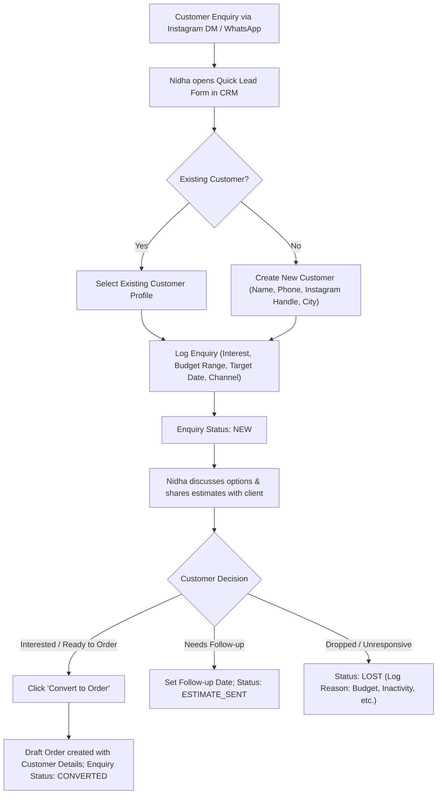
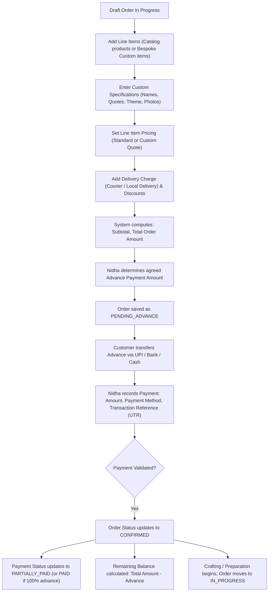
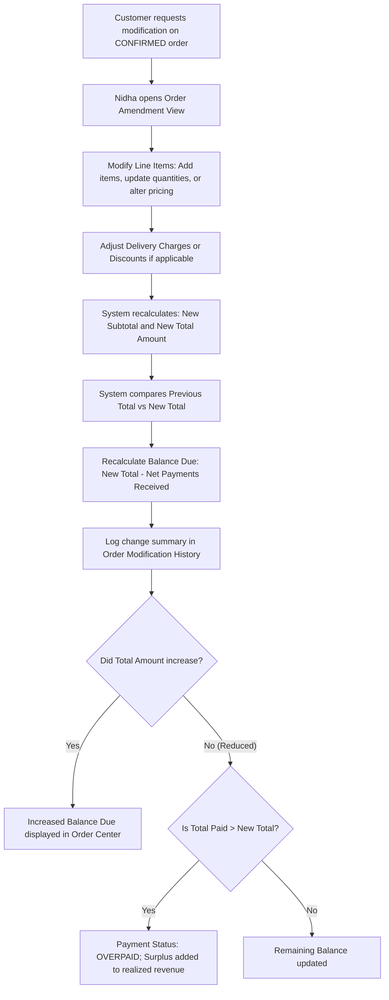
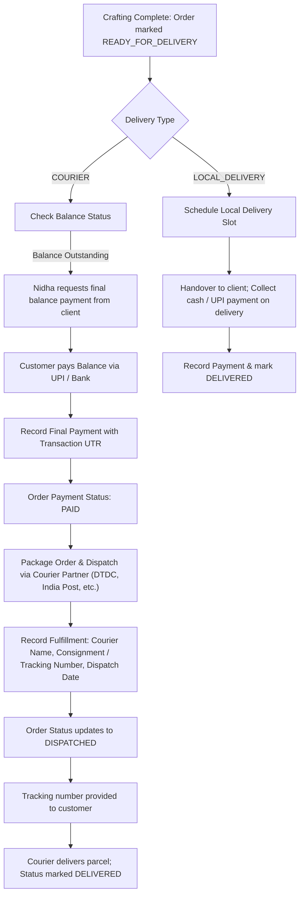
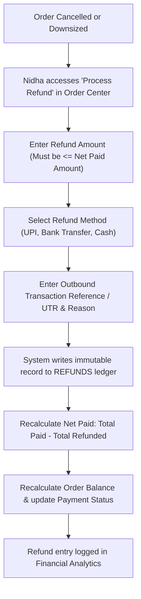
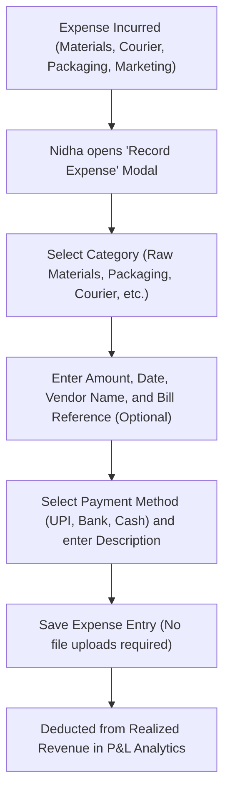

# Ninu Arts Business Manager — Business Workflows & Operating Rules

**Document Version:** 1.0.0  
**Architect:** Senior Software Architect & Product Engineer  

---

## 1. Overview of Core Business Workflows

This document establishes standard operating procedures and system workflows for Ninu Arts, codifying the complete lifecycle from initial Instagram/WhatsApp enquiry to fulfillment, payment reconciliation, and financial reporting.

---

## 2. Workflow 1: Lead Ingestion & Customer CRM Pipeline

Captures customer inquiries arriving through Instagram DMs, WhatsApp, or phone calls, ensuring no prospective gifting client is lost.

### Key Business Rules:
1. Every phone number recorded should ideally be WhatsApp-compatible.
2. Instagram handle is stored to reconcile DM conversations with phone numbers.
3. Converting an enquiry creates a draft order without needing duplicate entry of customer data.

---

## 3. Workflow 2: Order Booking, Custom Pricing & Advance Confirmation

Orders are confirmed only upon receipt of advance payment.

### Key Financial Rules:
1. **Advance Enforcement:** An order cannot transition to `CONFIRMED` until an advance payment is logged with status `SUCCESS`.
2. **Flexible Advance:** The advance amount is determined by Nidha (can be 0%, 30%, 50%, or 100% depending on customer trust and custom material requirements).
3. **Optional Transaction Reference:** Capturing the UTR / transaction ID is supported for reference, but remains strictly **optional** across all methods (UPI, Bank Transfer, Cash) so orders can be confirmed even when the customer doesn't supply the transaction ID immediately.

---

## 4. Workflow 3: Confirmed Order Modification (Amendment Workflow)

Customers frequently request alterations (e.g., adding a mini frame, upgrading album size, changing delivery address) after paying the advance.

### Key Business Rules:
1. Past payments are immutable; they remain linked to the order.
2. Every amendment requires a change note (e.g., "Customer added 1 mini album; courier changed to DTDC Express").
3. **Overpayment Treatment:** If total payments received exceed the new total order amount, the order is marked as `OVERPAID`, remaining balance is set to `0.00`, and the surplus is recognized directly into business revenue. Formal refund is not forced unless explicitly requested by Nidha.

---

## 5. Workflow 4: Balance Settlement, Dispatch & Fulfillment

Managing courier logistics and final balance collection.

### Key Logistics Rules:
1. Dispatch warning: If an order has an unpaid balance, the system displays a prominent amber warning before recording courier consignment.
2. Tracking information is mandatory for courier shipments to allow future automated WhatsApp dispatch notifications.

---

## 6. Workflow 5: Refund Processing

Covers order cancellations or downward price revisions.

### Key Financial Rules:
1. Total refunds cannot exceed the total amount successfully paid.
2. Outbound transaction reference must be recorded for UPI or Bank transfers.

---

## 7. Workflow 6: Operating Expense Logging

Tracking raw materials, tools, and courier costs to compute true business net profit.

### Key Accounting Rules:
1. Expenses are recorded separately from order cost.
2. Expense recording is fast and text-only (receipt document uploads are explicitly not required).
3. Net profit calculation:
   $$\text{Net Profit} = \text{Cash Collected from Orders} - \text{Total Operating Expenses} - \text{Total Refunds}$$
