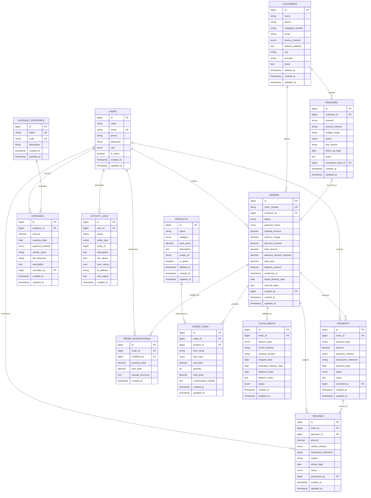

# Ninu Arts Business Manager — Database Entity Relationship Diagram (ERD)

**Document Version:** 1.0.0  
**Architect:** Senior Software Architect & Product Engineer  

---

## 1. Visual Entity Relationship Diagram

---

## 2. Cardinality & Relational Dictionary

### 2.1 Customer & Enquiry Relations
- **`CUSTOMERS` 1 : N `ENQUIRIES`**: A customer may initiate multiple enquiries over time (e.g., initial birthday inquiry, follow-up anniversary inquiry).
- **`ENQUIRIES` 0..1 : 0..1 `ORDERS`**: An enquiry may be dropped (`LOST`) or successfully converted into exactly one order (`converted_order_id`).

### 2.2 Customer & Order Relations
- **`CUSTOMERS` 1 : N `ORDERS`**: A customer may place multiple orders over their lifetime, fostering repeat business analytics and CRM value.

### 2.3 Order, Items & Modifications Relations
- **`ORDERS` 1 : 1..N `ORDER_ITEMS`**: Every order must contain at least one line item. An order can contain multiple items combining catalog products and bespoke custom artifacts.
- **`PRODUCTS` 0..1 : N `ORDER_ITEMS`**: Catalog products can be referenced in multiple order items. When a custom item is created from scratch, `product_id` is `NULL`.
- **`ORDERS` 1 : 0..N `ORDER_MODIFICATIONS`**: Whenever a confirmed order is amended (items changed, delivery added, prices updated), a change-log record is appended.

### 2.4 Financial Ledger Relations
- **`ORDERS` 1 : 0..N `PAYMENTS`**: An order can receive multiple payments (e.g., Advance payment first, Balance payment on dispatch/delivery).
- **`ORDERS` 1 : 0..N `REFUNDS`**: If an order is cancelled or modified downwards after payment, one or more refunds may be issued.
- **`PAYMENTS` 1 : 0..N `REFUNDS`**: A refund may optionally link directly back to the original incoming payment receipt.

### 2.5 Fulfillment Relations
- **`ORDERS` 1 : 0..1 `FULFILLMENTS`**: Every confirmed order has a single fulfillment tracking lifecycle (either courier consignment or local delivery).

### 2.6 Expense Relations
- **`EXPENSE_CATEGORIES` 1 : N `EXPENSES`**: Each expense record belongs to exactly one category (Raw Materials, Packaging, Courier, Marketing, Tools, Misc).
- **`USERS` 1 : N `EXPENSES`**: Audit trail of the user who paid and recorded the business expense.

### 2.7 Activity Log Relations
- **`USERS` 1 : 0..N `ACTIVITY_LOGS`**: Every log entry is linked to the operator who triggered the action. When a user is deleted, the log entry's `user_id` is set to `NULL` (preserving the immutable log record).
