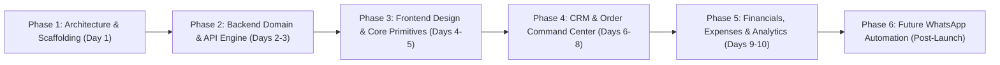

# Ninu Arts Business Manager — Development Roadmap & Implementation Plan

**Document Version:** 1.0.0  
**Architect:** Senior Software Architect & Product Engineer  

---

## 1. Project Phase Overview

---

## 2. Phase-by-Phase Breakdown

### Phase 1: Architecture, Scaffolding & Data Modeling (Current Milestone — Day 1)
- [x] Complete Business Requirements Document (`BUSINESS_REQUIREMENTS.md`).
- [x] Complete System Architecture Blueprint (`SYSTEM_ARCHITECTURE.md`).
- [x] Complete MySQL Schema Specification (`DATABASE_DESIGN.md`).
- [x] Complete Entity Relationship Diagram (`DATABASE_ERD.md`).
- [x] Complete REST API Specification (`API_SPECIFICATION.md`).
- [x] Complete Application Routing & Component Hierarchy (`APPLICATION_ROUTES.md`).
- [x] Complete Business Operating Workflows (`BUSINESS_WORKFLOWS.md`).
- [x] Complete Phased Roadmap (`DEVELOPMENT_ROADMAP.md`).
- [x] Initialize frontend directory structure, TypeScript configurations, Tailwind setup.
- [x] Initialize backend Laravel directory structure, environment configurations.

---

### Phase 2: Backend Core Services & API Implementation (Completed Milestone — Day 3)
- [x] **Database Migrations:** Created and executed all 8 migration files covering all 22+ approved domain entities (`users`, `roles`, `permissions`, `user_roles`, `personal_access_tokens`, `customers`, `customer_notes`, `customer_occasions`, `product_categories`, `products`, `orders`, `order_items`, `order_item_costs`, `order_status_history`, `order_modification_history`, `enquiries`, `follow_ups`, `payments`, `refunds`, `expense_categories`, `expenses`, `deliveries`, `activity_logs`, `business_settings`).
- [x] **Strict Financial Precision:** Verified `DECIMAL(10,2)` in INR on all monetary fields.
- [x] **Database Seeders:** `UserSeeder` (Nidha as OWNER + Staff account), `ProductCategorySeeder`, and `ExpenseCategorySeeder`.
- [x] **Eloquent Models:** `User`, `Customer`, `Order`, `OrderItem`, `Payment`, `ActivityLog`, `ProductCategory`, `Product`, `Enquiry`, `Delivery`, `Refund`, `ExpenseCategory`, `Expense`, `BusinessSetting`.
- [x] **Authentication & RBAC:** Laravel Sanctum integration, token issuance (`POST /api/v1/auth/login`), profile retrieval (`GET /api/v1/auth/me`), token revocation (`POST /api/v1/auth/logout`), role enforcement (`CheckRole` middleware).
- [x] **REST API Foundation:** `BaseApiController` standardizing response shapes (`{ success, data, meta }` and `{ success: false, error }`), error handlers, and 44 registered routes.
- [x] **Automated Test Suite:** 8/8 PHPUnit feature tests passing (24 assertions) verifying database connectivity, migrations, owner seeding, login, invalid login rejection, bearer token access, unauthenticated blocking, and role security.
- [x] **React-to-Laravel Integration:** Frontend `AuthContext` and `apiClient` wired to real Laravel endpoints, frontend simulation code replaced with real token-based session handling.

---

### Phase 3: Frontend Foundation & Component Library (Completed Milestone — Day 2)
- [x] **Tooling Setup:** Vite, React, TypeScript, Tailwind CSS with Ninu Arts brand palette (Warm Ivory `#FAF7F2`, Muted Rose `#B86B63`, Soft Beige, Deep Charcoal).
- [x] **Component Architecture:** Built reusable `AppSidebar`, `AppHeader`, `PageHeader`, `StatCard`, `DataTable`, `SearchInput`, `FilterDropdown`, `StatusBadge`, `FormDialog`, `ConfirmationDialog`, `EmptyState`, `LoadingState`, `ErrorState`.
- [x] **Application Shell & Views:** `DashboardOverviewPage` (KPI cards, Revenue AreaChart, Category Donut, Recent Orders, Delayed Orders alert, Payments ledger), `LoginPage`, `OrdersPage`, `EnquiriesPage`, `CustomersPage`, `ProductsPage`, `ExpensesPage`, `AnalyticsPage`, `ActivityLogsPage`, `SettingsPage`.
- [x] **Global Active Working Month Scoping:** `ActivePeriodContext` and `ActiveMonthPicker` enabling dynamic scoping across all views.
- [x] **Responsive Mobile Layout:** Collapsible sidebar with mobile overlay drawer.

---

### Phase 4: Customer CRM, Enquiry & Product Management (Completed Milestone — Day 4)
- [x] **Module 1: Customer Management:**
  - Auto-generated unique customer codes (`CUST-00001`, not phone as primary key).
  - Phone duplicate detection preventing duplicate profiles with HTTP 422 (`DUPLICATE_PHONE`).
  - Customer listing, create, edit, search, and status filtering (`ACTIVE`/`INACTIVE`).
  - Customer Detail view with complete contact info, lifetime spend, order count.
  - Internal customer notes timeline with user attribution and quick append (`POST /customers/{id}/notes`).
  - Purchase history section linking verified customer orders.
  - CSV Import wizard with column mapping, preview, duplicate detection (both database and file duplicates), validation reporting, and disclaimer stating historical imported records are not treated as verified financial transactions.
- [x] **Module 2: Enquiry Management:**
  - Lead pipeline listing with channel badges (Instagram DM, WhatsApp, Phone Call).
  - Create enquiry with auto-reuse of existing customer profile or creation of new prospect.
  - Estimated commercial value in INR (`DECIMAL(10,2)`), requirements, enquiry date, and status tracking (`NEW`, `CONTACTED`, `DISCUSSING`, `QUOTED`, `CONVERTED`, `LOST`).
  - Scheduled follow-up tracker (`FollowUp` model & `POST /enquiries/{id}/follow-ups`).
  - Lost reason capture upon transitioning status to `LOST`.
  - **Critical Feature:** Convert enquiry to order:
    - Auto-reuses customer profile without duplicate customer creation.
    - Preserves enquiry history and links order to enquiry (`converted_order_id`).
    - **Accidental double conversion prevention** (HTTP 422 `ENQUIRY_ALREADY_CONVERTED` and UI lock).
- [x] **Module 3: Product Management:**
  - Flexible catalogue supporting photo frames, magazine albums, hampers, and custom gifts.
  - Product fields: Name, Category, Description, Base Price in INR, Image URL / Upload, Status.
  - Product image upload endpoint (`POST /products/upload-image`).
  - Soft-delete archiving (`DELETE /products/{id}`) and restoring (`POST /products/{id}/restore`).
  - Category taxonomy management CRUD (`/product-categories`) with cascade protection.
  - Explicit UI guidance stating custom bespoke products can be quoted and crafted during order creation without forcing catalogue pre-configuration.
- [x] **Automated Testing & Integration:**
  - 17/17 PHPUnit feature tests passing (60 assertions), covering customer creation, phone duplicate rejection, customer notes, CSV import, enquiry customer reuse, follow-up scheduling, enquiry conversion, double conversion rejection, and product lifecycle (create, edit, archive, restore).
  - Frontend production build (`tsc -b && vite build`) compiling cleanly with 0 errors.

---

### Phase 5: Order Management & Payment System (Completed Milestone — Day 5)
- [x] **Module 1: Order Management:**
  - Order listing, multi-field search (order #, client name, phone, item name, notes), and status/payment filters.
  - Multi-product order creation wizard supporting both catalogue presets and custom bespoke products.
  - Customization instructions and direct material cost tracking (`order_item_costs`) per line item.
  - Decimal-safe financial calculations in INR: `Subtotal = sum(item * qty)`, `Total = Subtotal + Shipping - Discount`, `Balance = Total - Net Paid`.
  - **Critical Lifecycle Rules:**
    - Draft order creation without upfront payment.
    - **Zero advance rejection on confirmation:** An order can only transition to `CONFIRMED` after recording a valid advance payment.
    - Soft-delete protection: confirmed orders with financial records are guarded against permanent deletion.
    - Historical price preservation: snapshot item unit prices on creation; subsequent catalogue price adjustments do not mutate historical orders.
  - **Order Modification History:**
    - Full post-confirmation amendments logging (`order_modification_history`) with previous snapshot, new snapshot, modification reason, and staff user ID.
  - **Order Status History:**
    - Audit log for all state transitions (`DRAFT`, `CONFIRMED`, `IN_PROGRESS`, `READY`, `DISPATCHED`, `DELIVERED`, `ON_HOLD`, `CANCELLED`).
- [x] **Module 2: Payment & Refund Management:**
  - Multi-method support: `UPI`, `BANK_TRANSFER`, `CASH`.
  - Transaction reference (UTR) tracking (optional for cash receipts).
  - Duplicate payment submission prevention for identical transaction references on an order.
  - Advance, partial, interim, and final settlement payment recording with automatic balance recalculation.
  - Auto-order confirmation upon recording valid advance payment.
  - **Refund Management:**
    - Separate refund record in `refunds` table preserving original payment history.
    - **Refund Limit Ceiling:** strictly validates that refund amount does not exceed net paid balance.
- [x] **Frontend Command Center UI:**
  - Order creation wizard with real-time financial breakdown.
  - Dynamic multi-product editor with catalogue selector.
  - Interactive Order Command Center with financial summary cards (Total, Paid, Balance, Advance Required).
  - Payments ledger tab and Record Payment modal.
  - Refund ledger tab and Process Refund modal.
  - Audit timeline tab showing lifecycle transitions and modification histories.
- [x] **Automated Testing & Verification:**
  - 29/29 PHPUnit feature tests passing (112 assertions), including 12 comprehensive Day 5 tests covering single/multi-product orders, custom items, variable advance, zero advance rejection on confirmation, partial/multiple payments, cash payments, duplicate payment rejection, refund processing, refund limit validation, modification history logging, historical price preservation, and deletion protection.
  - Frontend production build (`tsc -b && vite build`) passed with 0 errors.

---

### Phase 6: Financials, Expenses, Analytics & Testing (Next Milestone — Days 6–7)
- **Expense Module:** Expense log table, category filtering, new expense recording drawer.
- **Financial Analytics Dashboard:**
  - Executive KPI metric cards (Realized Cash Flow, Outstanding Balance, Operating Expenses, Net Income).
  - Recharts sales performance trend (Daily / Monthly bookings).
  - Lead channel acquisition comparison (Instagram vs WhatsApp).
- **Verification & Edge-Case Testing:**
  - Concurrency checks on balance recalculations.
  - Overpayment and partial refund handling.
  - Form validation on zero/negative values.

---

### Phase 6: Post-Launch & Future Messaging Automation (Future Scope)
- **WhatsApp Cloud API Integration:** Webhook listeners on `OrderConfirmedEvent` and `OrderDispatchedEvent` sending automated WhatsApp templates with order confirmation and courier tracking links directly to clients.
- **Instagram Graph API Direct Messaging:** Automated quick replies for enquiry intake.
- **Multi-Staff Onboarding:** Additional assistant accounts with restricted financial views.

---

## 3. Risk Assessment & Mitigation Strategies

| Risk / Challenge | Impact | Mitigation Strategy |
| :--- | :---: | :--- |
| **Financial Discrepancies during Order Amendments** | High | All modifications recalculate totals from atomic line items inside a database transaction (`DB::transaction`). Previous totals are archived in `order_modifications`. |
| **Unrecorded Advance Payments** | High | Order status is strictly guarded: cannot transition from `PENDING_ADVANCE` to `CONFIRMED` without an attached successful payment ledger record. |
| **Missing Courier Tracking Details** | Medium | System prompts for tracking number upon selecting `COURIER` dispatch; alerts user if balance is still unpaid before shipping. |
| **Data Loss from Deletions** | High | Soft deletes applied to customers and products; hard deletion is prohibited on orders, payments, and expenses. All changes captured in `activity_logs`. |

---

## 4. Architectural Decisions Confirmed (Day 1)

1. **Transaction References (UTR):** Optional across all payment channels (UPI, Bank, Cash) to accommodate customers who transfer advances without immediately supplying the UTR/transaction ID.
2. **Receipt Uploads:** Out of scope. Expense recording is text-only (vendor, description, bill reference, amount, date), avoiding unnecessary file storage overhead.
3. **Overpayment Revenue Recognition:** Any amount collected exceeding the total order value is tagged as `OVERPAID`, balance due is set to ₹0.00, and the entire cash inflow is counted in realized revenue. Refunds are processed only when manually requested.
4. **Fulfillment Logistics:** Manual courier partner and tracking number entry for launch; automated courier API integration (e.g., Shiprocket) deferred to post-launch enhancements.
5. **Universal System Audit Logging:** Every single action, modification, payment entry, status change, and deletion across the system is immutably logged into `activity_logs` with before/after diffs, operator ID, timestamp, and IP address.
6. **Global Active Working Month Scoping:** System defaults to the current calendar month across all views (Orders, Enquiries, Payments, Expenses, Analytics). A global month/year selector in the topbar and settings allows switching the active working period (e.g., to August 2027), filtering all views strictly to that month.
7. **Rollout Timeline:** Pilot operations starting December 2026; full daily operational cutover from January 2027.

